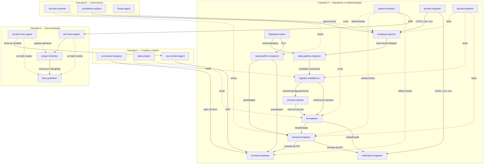

# Arquitetura de Subagents — Road News

Este documento é o guia de uso, para humanos, do roster de 23 subagents do Road News. Os agentes em si vivem como arquivos executáveis em [`.claude/agents/*.md`](../.claude/agents) — o frontmatter (`description`) é o que o Claude Code usa para rotear automaticamente; este documento explica quando cada um é acionado, o que cada um nunca faz, como se relacionam, e os workflows que orquestram vários agentes numa mudança real. O racional da decisão está em [`docs/adr/0001-arquitetura-de-subagents.md`](adr/0001-arquitetura-de-subagents.md).

**Premissa estrutural, válida para todo este documento**: os agentes descrevem e defendem o stack real do Road News hoje — scraper Python sem browser headless (feedparser/BeautifulSoup), API em Vercel Serverless Functions com Node vanilla sem dependências (sem package.json), frontend em arquivo único (public/index.html, sem build step), Supabase Postgres com RLS, deploy só Vercel + GitHub Actions, testes com `unittest`/`node:test`. A stack "de referência" mais ampla (Next.js/NestJS, Playwright/Crawl4AI/Firecrawl, Docker/Coolify/Railway/Azure, Jest/Vitest) é uma **caixa de ferramentas futura**: `system-architect` e o agente dono de cada artefato a habilitam sob demanda, via ADR, quando um caso concreto justificar — nunca por padrão.

---

## Roster

### Camada A — Arquitetura e Implementação

| Slug | Modelo | Missão em uma linha |
|---|---|---|
| `system-architect` | opus | Estrutura, limites de módulo, ADRs, avaliação de impacto arquitetural |
| `scraping-engineer` | sonnet | Coleta: fontes RSS/HTML/API, seletores, keywords, resiliência |
| `data-pipeline-engineer` | sonnet | Normalização, deduplicação semântica, resolução de entidade |
| `ai-engineer` | sonnet | Infraestrutura de chamada a LLM: schema, fallback, cache, custo por chamada |
| `prompt-engineer` | sonnet | Texto de prompt, versionamento, teste A/B contra dataset dourado |
| `logistics-intelligence` | opus | Taxonomia, régua de severidade, formato de inteligência operacional |
| `database-expert` | opus | Schema, migrations, índices, RLS, planos de execução |
| `backend-engineer` | sonnet | Endpoints de produto em `api/**` |
| `frontend-engineer` | sonnet | Painel em `public/index.html` |
| `notification-engineer` | sonnet | Entrega de alerta/resumo: e-mail, roteamento, anti-flood |
| `saas-platform-engineer` | sonnet | Multi-tenancy: auth, papéis, pacotes, quotas, provisionamento |
| `devops-engineer` | sonnet | CI/CD, GitHub Actions, Vercel, variáveis de ambiente |
| `qa-test-engineer` | sonnet | Testes unitários, regressão, contrato |

### Camada B — Governança e Revisão (somente leitura de código)

| Slug | Modelo | Missão em uma linha |
|---|---|---|
| `security-reviewer` | opus | SSRF, XSS, isolamento de tenant, segredo exposto, authz/authn |
| `compliance-advisor` | opus | robots.txt/ToS, direito autoral, LGPD de dado citado em notícia |
| `finops-agent` | opus | Custo total (IA, infra, terceiros) e trade-off de economia |

### Camada C — Produto e Dados

| Slug | Modelo | Missão em uma linha |
|---|---|---|
| `ux-product-designer` | sonnet | Fluxo e hierarquia de informação do painel |
| `data-analyst` | sonnet | Métricas de volume, qualidade, latência, engajamento |
| `seo-content-agent` | sonnet | Meta tags, robots.txt/sitemap.xml, palavra-chave |

### Camada D — Documentação e Memória Institucional

| Slug | Modelo | Missão em uma linha |
|---|---|---|
| `product-docs-agent` | sonnet | `/product`: posicionamento, pricing, personas, mercado |
| `tech-docs-agent` | sonnet | README + `/docs`: arquitetura, API, banco, deploy |
| `project-historian` | haiku | `docs/HISTORY.md`: registro fiel de toda mudança |
| `docs-publisher` | haiku | Consolida `/product` + `/docs` em um PDF único, sempre no mesmo caminho |

---

## Matriz de propriedade de arquivo

Princípio inegociável: nenhum caminho abaixo tem dois agentes com `Write`/`Edit`.

| Caminho | Dono exclusivo |
|---|---|
| `scraper/sources/**`, `scraper/utils/filters.py`, `config/sources.yaml` | scraping-engineer |
| `scraper/storage/**`, resolução de entidade/dedup semântica | data-pipeline-engineer |
| Código de chamada a LLM dentro de `event_intelligence.py`, `image_summary.py`, `weekly_news.py`, `news-feed.js` | ai-engineer |
| `/prompts/**` (texto de prompt, a criar) | prompt-engineer |
| `docs/domain/**` (taxonomia, régua, dataset dourado) | logistics-intelligence |
| `scripts/*.sql` | database-expert |
| `api/news-feed.js`, `news-summary.js`, `weekly-summary.js` (orquestração), `my-access.js`, `usage-event.js`, `auth-config.js` | backend-engineer |
| `public/**` exceto `robots.txt`/`sitemap.xml`/`blog/**` | frontend-engineer |
| `scraper/weekly_news.py` (template/envio), `api/weekly-summary.js` (disparo), `scripts/send_weekly_news.py`, conteúdo/destinatários de `.github/workflows/weekly-news.yml` | notification-engineer |
| `api/_auth.js`, `api/_admin.js`, `api/admin-*.js` (6 arquivos) | saas-platform-engineer |
| `.github/workflows/**` (mecânica: cron, steps, secrets), `vercel.json`, `.vercelignore`, `.env.example` | devops-engineer |
| `tests/**` | qa-test-engineer |
| `docs/adr/**` | system-architect |
| `public/robots.txt`, `public/sitemap.xml`, futuro `public/blog/**`, `docs/seo/**` | seo-content-agent |
| `docs/ux/**` | ux-product-designer |
| `docs/metrics/**` | data-analyst |
| `/product/**` | product-docs-agent |
| `README.md`, `docs/*.md` (raiz), `docs/diagramas/**`, `docs/AGENTS.md` | tech-docs-agent |
| `docs/HISTORY.md` | project-historian |
| `docs/dist/road-news-documentation.pdf`, `docs/dist/.docs-pdf-manifest.json`, `scripts/build-docs-pdf.js`, `scripts/package.json` | docs-publisher |
| — (sem propriedade de arquivo, só leitura) | security-reviewer, compliance-advisor, finops-agent |

---

## Grafo de dependências



---

## Sobreposições resolvidas

### Herdadas da especificação original do roster

1. **`news-intelligence-agent` + `news-intelligence-analyst` → fundidos em `logistics-intelligence`.** Ambos operavam sobre a mesma notícia com o mesmo conhecimento de domínio — mantê-los separados criaria duas fontes de verdade para a taxonomia.
2. **`ai-engineer` × `prompt-engineer` — mantidos separados.** Código (roteador, cache, schema, retries) e texto (prompt versionado, testado contra dataset dourado) têm ciclos de teste e critério de sucesso distintos.
3. **`cost-optimization-agent` → `finops-agent`, escopo ampliado.** Restrito a LLM seria subconjunto de `ai-engineer`; ampliado a custo total (infra, storage, terceiros) é transversal a A4/A7/A12 e legitimamente separado.
4. **`documentation-writer` = `tech-docs-agent`.** Duplicata eliminada.
5. **`product-docs-agent` × `seo-content-agent` — hierarquia.** `/product` é fonte de verdade de posicionamento; SEO deriva dela.
6. **`security-reviewer` × `compliance-advisor` — perguntas diferentes.** "Dá pra invadir/vazar?" vs. "podemos legalmente coletar, armazenar e redistribuir isso?" exigem conhecimento totalmente distinto.
7. **`data-analyst` × `ai-engineer`/`prompt-engineer`.** Quem mede não deve ter incentivo de melhorar o próprio número.

### Encontradas durante a implementação (residuais desta entrega)

8. **ADR: `system-architect` vs. `tech-docs-agent`.** A especificação original listava ADRs como responsabilidade dos dois (A1 "escreve ADRs"; D2 "mantém /docs e /docs/adr"). Resolvido: `system-architect` é o único com `Write` em `docs/adr/**` — é quem decide e assina a decisão arquitetural. `tech-docs-agent` lê e referencia ADRs a partir de `docs/*.md`, nunca os edita.
9. **`docs/adr` também aparecia na missão de `project-historian`.** A especificação original listava "Registra... em `/docs/HISTORY.md` + `/docs/adr`" para D3. Resolvido: `project-historian` só escreve em `docs/HISTORY.md`; quando a mudança nasceu de uma decisão arquitetural, ele **referencia** o número do ADR, nunca escreve dentro de `docs/adr/**`.
10. **`api/**` dividido entre `backend-engineer` e `saas-platform-engineer`.** A especificação original dava "APIs REST" a A8 e "multi-tenancy" a A11 sem dividir arquivos concretamente — no repositório real isso colidiria em todo `api/*.js`. Resolvido: `saas-platform-engineer` é dono exclusivo do motor de tenancy (`api/_auth.js`, `api/_admin.js`, `api/admin-*.js`, 6 arquivos); `backend-engineer` é dono dos endpoints de produto que **consomem** esse motor (`news-feed.js`, `news-summary.js`, `weekly-summary.js`, `my-access.js`, `usage-event.js`, `auth-config.js`).
11. **`scraper/storage` entre `scraping-engineer` e `data-pipeline-engineer`.** Resolvido: `scraping-engineer` é dono da coleta e do filtro de keyword (`scraper/sources/**`, `scraper/utils/filters.py` — que o próprio README do projeto já trata como parte da coleta); `data-pipeline-engineer` é dono da persistência e da resolução de entidade (`scraper/storage/**`).
12. **`scraper/weekly_news.py` toca três agentes ao mesmo tempo.** É um único arquivo que gera texto com IA, usa um prompt, e envia e-mail. Resolvido por sub-responsabilidade dentro do mesmo arquivo: chamada de IA = `ai-engineer`; texto do prompt = `prompt-engineer`; template/destinatário/disparo = `notification-engineer`. Nenhum edita a parte dos outros sem coordenação explícita — é a única exceção deliberada a "um dono por arquivo", justificada por ser um arquivo pequeno com responsabilidades genuinamente ortogonais em faixas de linha diferentes.
13. **Carve-out de `/docs` para C1/C2/C3.** A especificação original não detalhava onde `ux-product-designer`, `data-analyst` e `seo-content-agent` escrevem, o que colidiria com `tech-docs-agent`. Resolvido: subpastas próprias — `docs/ux/`, `docs/metrics/`, `docs/seo/`.
14. **`public/index.html` entre `frontend-engineer` e `seo-content-agent`.** A landing pública e o painel logado são o mesmo arquivo (SPA de arquivo único) — um cenário que a especificação original, pensada para uma landing separada de Next.js, não previa. Resolvido: `frontend-engineer` mantém `Write` exclusivo sobre `public/index.html`; `seo-content-agent` entrega brief/diff textual de meta tag e copy, nunca edita o arquivo diretamente. `seo-content-agent` só tem `Write` direto sobre artefatos que genuinamente não colidem (`public/robots.txt`, `public/sitemap.xml`, futuro `public/blog/**`).
15. **`docs-publisher` (adicionado depois do roster inicial de 22) introduziu a primeira dependência npm do projeto.** `scripts/build-docs-pdf.js` usa `markdown-it` + `puppeteer`, isolados num `scripts/package.json` próprio — não afeta `api/` (que continua zero-dependência) nem o scraper Python. Essa decisão foi validada explicitamente com o usuário antes da implementação, diante da alternativa de escrever em Python (mais consistente com o resto do projeto, mas não executável na máquina de desenvolvimento usada na sessão, que não tinha Python instalado). Registrada aqui, não em ADR à parte, por ser uma decisão pontual de ferramenta de build, não uma mudança de arquitetura de produto.
16. **`.gitignore` tinha uma regra `dist/` genérica que ignoraria `docs/dist/` por engano.** As linhas `dist/`/`build/` do `.gitignore` (pensadas para artefatos de empacotamento Python na raiz) não tinham `/` inicial, então também casavam com `docs/dist/`, onde `docs-publisher` precisa versionar o PDF e o manifest. Corrigido para `/dist/`/`/build/` (ancorado à raiz do repositório), preservando a intenção original sem bloquear o novo agente.

---

## Workflows oficiais

### 1. Nova feature

```
system-architect       → impacto arquitetural, onde mora o código, ADR se necessário
ux-product-designer     → fluxo e telas (se houver superfície de usuário)
logistics-intelligence  → regra de domínio (se tocar classificação/severidade)
database-expert         → schema + migration + índices
backend-engineer        → API, integrações
frontend-engineer       → painel
saas-platform-engineer  → isolamento por tenant, quota, plano
qa-test-engineer        → testes antes ou junto da implementação
security-reviewer       → revisão bloqueante
finops-agent            → custo marginal por notícia e por tenant (se tocar IA/infra)
tech-docs → product-docs → project-historian → docs-publisher   [Definition of Done]
```

### 2. Correção de bug

```
qa-test-engineer        → teste que reproduz o bug (falha primeiro)
[agente dono da área]   → correção mínima
system-architect        → só se a causa raiz for estrutural
security-reviewer       → se o bug tocar auth, dado de tenant, input externo ou dependência
qa-test-engineer        → regressão verde
tech-docs (se mudou comportamento público) → project-historian → docs-publisher   [Definition of Done]
```

### 3. Novo scraper / novo portal

```
compliance-advisor      → robots.txt, ToS, limites de citação  [BLOQUEANTE se reprovar]
scraping-engineer       → estratégia (RSS > API pública > HTML > renderização client-side), seletores, rate limit
data-pipeline-engineer  → normalização, dedup contra fontes existentes, mapeamento de entidades
logistics-intelligence  → a fonte agrega cobertura de qual categoria? amostra rotulada
qa-test-engineer        → fixtures de HTML/RSS congelado + teste de contrato do parser
finops-agent            → custo incremental (páginas × IA × storage)
data-analyst            → mede ganho real de cobertura após 7 dias
tech-docs (SCRAPERS.md) → product-docs (se ampliar cobertura vendável) → project-historian → docs-publisher
```

### 4. Deploy em produção

```
qa-test-engineer        → suíte completa verde (unittest + node:test, local e no CI `.github/workflows/tests.yml`)
security-reviewer        → sem [BLOQUEANTE] em aberto
devops-engineer          → deploy via push na main (Vercel), plano de rollback identificado
saas-platform-engineer   → smoke test de isolamento entre dois tenants reais
data-analyst             → baseline pré-deploy das métricas-chave
devops-engineer          → observação pós-deploy: erro, latência fonte→alerta, custo/hora
tech-docs (DEPLOY.md, CHANGELOG.md) → product-docs (se release para cliente) → project-historian → docs-publisher
```

### 5. Ciclo de otimização de IA (recorrente, mensal)

```
data-analyst             → precisão, recall, falsos positivos por categoria
finops-agent             → custo por notícia e projeção mensal
prompt-engineer          → hipótese + teste A/B contra dataset dourado
ai-engineer               → roteamento, cache, pré-filtro, batching
logistics-intelligence    → valida que a qualidade de domínio não regrediu  [BLOQUEANTE]
tech-docs (AI_PIPELINE.md) → project-historian → docs-publisher
```

---

## Uso por agente

Cada seção cobre: objetivo, responsabilidades, gatilhos de uso, casos de não-uso (com o agente correto), ferramentas/conhecimentos, 3 exemplos, critérios de sucesso/falha e relação com o resto do roster. O texto completo do system prompt de cada agente está em `.claude/agents/<slug>.md`.

### system-architect

**Objetivo:** garante que toda decisão estrutural do Road News seja deliberada e registrada, para que os outros 21 agentes implementem dentro de limites claros em vez de decidir arquitetura ad hoc.
**Responsabilidades:** estrutura de pastas e limites de módulo · decidir quando dependência/framework/runtime novo se justifica · escrever ADRs · avaliar impacto arquitetural de feature multi-camada · arbitrar conflito de propriedade de arquivo · manter CLAUDE.md coerente com a arquitetura vigente · vetar dependência nova em `api/**` sem análise.
**Quando usar:** "onde deveria morar esse código novo?" · "precisamos de fila/Docker/framework pra isso?" · "dois agentes discordam de quem é dono deste arquivo" · "essa feature toca scraper, API e painel ao mesmo tempo, como sequenciar?"
**Quando NÃO usar:** implementar a feature em si (→ agente dono do artefato) · decidir preço/posicionamento (→ product-docs-agent) · decidir taxonomia de severidade (→ logistics-intelligence) · escrever documentação técnica fora de ADR (→ tech-docs-agent).
**Ferramentas e conhecimentos:** Read, Grep, Glob, Write (`docs/adr/**` apenas); arquitetura serverless, custo de infraestrutura, histórico de ADRs do projeto.
**Exemplos de uso:**
1. *"Quero Playwright pra raspar um portal com paywall JS"* → avalia se RSS/HTML estático resolve, pesa custo de manutenção → ADR aprovando ou rejeitando com alternativa.
2. *"backend-engineer quer adicionar axios ao api/"* → verifica se `fetch` nativo resolve → rejeita, mantém zero dependências.
3. *"Vamos lançar alerta em tempo real via WhatsApp"* → mapeia agentes participantes e ordem → plano de sequenciamento + sinalização de que ADR é necessário.
**Critérios de sucesso:** ADRs com alternativas descartadas documentadas · nenhuma dependência nova sem revisão · nenhum módulo novo duplica agente existente.
**Critérios de falha:** aprovar infraestrutura por "boa prática" sem limitação real observada · escrever código de feature · deixar dois agentes com Write no mesmo arquivo sem arbitrar.
**Relação com outros subagents:** Upstream: nenhum — é o ponto de entrada para decisão estrutural. Downstream: toda a Camada A implementa dentro dos limites que define. Conflito histórico: com tech-docs-agent sobre `docs/adr` (ver sobreposição residual #8), resolvido por propriedade exclusiva de `docs/adr/**`.

### scraping-engineer

**Objetivo:** garante que toda notícia relevante de rodovia chegue ao pipeline, com o menor custo de manutenção possível, sem duplicar responsabilidade de normalização.
**Responsabilidades:** fontes RSS/HTML/API novas · seletores em `scraper/sources/**` · motor de keyword em `scraper/utils/filters.py` · `config/sources.yaml` · estratégia de anti-bot/rate limit/retry · diagnóstico de fonte parada.
**Quando usar:** "adiciona esse portal como fonte" · "o seletor da Band quebrou" · "essa fonte parou de retornar itens" · "quero ajustar as keywords que filtram o G1/CNN".
**Quando NÃO usar:** mesma ocorrência em 2 portais virando 2 alertas (→ data-pipeline-engineer) · qualquer chamada a LLM (→ ai-engineer) · mudar o cron do GitHub Actions (→ devops-engineer) · aprovar fonte nova legalmente (→ compliance-advisor).
**Ferramentas e conhecimentos:** Read, Grep, Glob, Write, Edit, Bash; feedparser, requests, BeautifulSoup4, lxml, semântica de matching de keyword do projeto.
**Exemplos de uso:**
1. *"Adicione a Nova Dutra como fonte de notícias"* → verifica se existe RSS/API antes de HTML, implementa em `scraper/sources/`, testa com `python main.py` → PR com contagem de itens coletados no teste local.
2. *"O parser da Band está retornando 0 itens"* → compara seletor atual com o HTML ao vivo, identifica mudança de classe CSS → correção + nota do que mudou na fonte.
3. *"Quero que 'ponte' também dispare alerta"* → avalia risco de falso positivo da palavra isolada, propõe termo composto mais preciso → atualização de `config/sources.yaml` com justificativa.
**Critérios de sucesso:** fonte nova aparece na saída de teste local com `category` definida · nenhuma fonte derruba o batch inteiro ao falhar · mudança de keyword documentada e comunicada a data-analyst.
**Critérios de falha:** ativar fonte em produção sem revisão de compliance-advisor · adicionar scraping HTML quando RSS/API já resolveria · deixar item sem título/URL chegar em storage.
**Relação com outros subagents:** Upstream: compliance-advisor (aprova fonte), system-architect (aprova dependência Python nova). Downstream: data-pipeline-engineer (recebe itens brutos), qa-test-engineer (testa contrato do parser), finops-agent (avalia custo de fonte de alto volume). Conflito: com data-pipeline-engineer sobre `scraper/storage` (ver sobreposição residual #11), resolvido por fronteira coleta vs. persistência.

### data-pipeline-engineer

**Objetivo:** evita que a mesma ocorrência de rodovia vire múltiplos alertas para o cliente, e transforma texto solto de km/rodovia em entidade identificável.
**Responsabilidades:** deduplicação semântica entre fontes · consolidação de extração de rodovia/km/UF/trecho · normalização de fuso e data · idempotência de reprocessamento · `scraper/storage/**`.
**Quando usar:** "essas 3 notícias são o mesmo acidente, por que viraram 3 alertas?" · "preciso consolidar a extração de rodovia que hoje está em 2 lugares diferentes" · "rodar o pipeline de novo duplicou dado" · "km está em formatos diferentes entre fontes".
**Quando NÃO usar:** decidir seletor/fonte nova (→ scraping-engineer) · chamar LLM ou decidir schema de resposta de IA (→ ai-engineer) · decidir o que é "crítico" (→ logistics-intelligence) · escrever a query de API que consome o dado resolvido (→ backend-engineer).
**Ferramentas e conhecimentos:** Read, Grep, Glob, Write, Edit, Bash; psycopg3, modelagem de chave determinística, normalização de texto/fuso horário.
**Exemplos de uso:**
1. *"G1 e CNN publicaram sobre o mesmo tombamento na BR-116"* → funde por chave rodovia+km+janela de tempo, não por similaridade de título → um único evento com duas fontes como evidência.
2. *"Consolide a extração de highway/km que hoje é regex duplicada"* → compara saída antiga (news-feed.js) com a nova numa amostra real → relatório de divergência antes de substituir.
3. *"Reprocessar o histórico com o novo pipeline"* → roda com identificador de lote, verifica idempotência → confirma que rodar 2x não duplica nem regride campo já enriquecido.
**Critérios de sucesso:** fusão de evento sempre com chave determinística auditável · reprocessamento seguro para rodar 2x · campo de localização ausente nunca inferido por aproximação.
**Critérios de falha:** fundir eventos só por similaridade textual · aplicar fusão retroativa sem aviso · propor query sem índice sobre tabela de milhões de linhas.
**Relação com outros subagents:** Upstream: scraping-engineer (itens brutos), database-expert (schema/índices). Downstream: logistics-intelligence (consome entidade resolvida), ai-engineer (classifica sobre dado já limpo). Conflito: com scraping-engineer sobre `scraper/storage` (resolvido, ver #11).

### ai-engineer

**Objetivo:** garante que toda chamada a modelo de IA no Road News seja barata, previsível no formato de resposta, e nunca derrube o produto quando a IA falhar.
**Responsabilidades:** código de chamada HTTP a LLM · JSON schema estrito · parsing/validação de saída · retries/timeout · fallback determinístico · cache/idempotência · medição de tokens.
**Quando usar:** "adiciona uma chamada de IA nova" · "a resposta da IA às vezes vem em formato errado" · "quero trocar o modelo" · "a chamada de IA falhou e derrubou a feature inteira".
**Quando NÃO usar:** mudar o texto do prompt (→ prompt-engineer) · decidir o que é "crítico"/os campos do schema (→ logistics-intelligence) · decidir se o custo está bom (→ finops-agent) · adicionar provedor novo sem ADR (→ system-architect).
**Ferramentas e conhecimentos:** Read, Grep, Glob, Write, Edit, Bash; OpenAI Responses API, JSON Schema estrito, padrões de retry/fallback, o padrão-ouro já implementado em `event_intelligence.py`.
**Exemplos de uso:**
1. *"Adiciona classificação de imagem para a nova fonte de clima"* → replica o padrão de pré-filtro + schema estrito + fallback de `event_intelligence.py` → função nova com fallback determinístico documentado.
2. *"A IA de resumo semanal falhou ontem e o e-mail não saiu"* → identifica que faltava fallback → adiciona caminho sem IA (resumo baseado em regra) antes de corrigir a causa da falha.
3. *"Quer testar gpt-4.1 em vez de gpt-4.1-mini"* → confirma que a troca é via variável de ambiente, não hardcode → PR com o override documentado, sem mudar o default sem aprovação.
**Critérios de sucesso:** toda chamada de IA tem fallback funcional sem a chave presente · nenhuma resposta é gravada sem passar por schema estrito · reprocessar não duplica chamada.
**Critérios de falha:** função que só funciona com IA disponível · afrouxar `strict: true` · aceitar confidence abaixo do mínimo definido por logistics-intelligence.
**Relação com outros subagents:** Upstream: logistics-intelligence (schema/régua), prompt-engineer (texto a injetar), data-pipeline-engineer (dado já limpo). Downstream: backend-engineer e notification-engineer (consomem a classificação), finops-agent (recebe métricas de token). Conflito: nenhum residual — fronteira com prompt-engineer já era limpa na especificação original.

### prompt-engineer

**Objetivo:** trata o texto de prompt como artefato de engenharia versionado e testado, não como string solta dentro do código de aplicação.
**Responsabilidades:** texto de todo prompt · estrutura de `/prompts/**` (a criar) · redução de tokens sem perda de precisão · teste A/B contra dataset dourado · migração de texto quando o modelo muda.
**Quando usar:** "muda o texto que pede pra IA classificar o evento" · "esse prompt está gastando token demais" · "testa se essa mudança de prompt piora a precisão" · "extrai esse prompt inline pra um lugar versionado".
**Quando NÃO usar:** escrever a chamada HTTP/parsing (→ ai-engineer) · decidir os campos do schema de saída (→ logistics-intelligence, prompt-engineer só escreve o texto que os pede) · mexer em pipeline/storage (→ data-pipeline-engineer/ai-engineer).
**Ferramentas e conhecimentos:** Read, Grep, Glob, Write, Edit; engenharia de prompt, avaliação A/B, os 4 prompts inline hoje existentes no projeto como referência de estilo.
**Exemplos de uso:**
1. *"Extraia os prompts inline pra /prompts"* → copia texto de `event_intelligence.py`, `news-feed.js`, `weekly_news.py`, `image_summary.py` sem mudar conteúdo → 4 arquivos versionados + diff de origem apontando para o novo local.
2. *"Reduza o tamanho do prompt de triagem de eventos"* → testa a versão reduzida contra o dataset dourado → relatório de tokens antes/depois e precisão/recall antes/depois.
3. *"Adapte o prompt de resumo semanal pro tom mais executivo"* → mantém a cláusula anti-alucinação intacta, ajusta só o tom → nova versão `v2` com A/B documentado.
**Critérios de sucesso:** todo prompt de produção tem versão anterior rastreável · toda mudança testada contra dataset dourado antes de produção · cláusula anti-alucinação presente em todo prompt de classificação.
**Critérios de falha:** trocar texto de prompt ativo sem teste A/B · misturar mudança de conteúdo com mudança de local no mesmo PR · remover a cláusula anti-alucinação "para simplificar".
**Relação com outros subagents:** Upstream: logistics-intelligence (regras de domínio a incluir), ai-engineer (onde o texto é injetado). Downstream: ai-engineer (usa o texto na chamada), data-analyst (mede impacto do teste A/B). Conflito: nenhum residual — fronteira com ai-engineer confirmada como correta (sobreposição herdada #2).

### logistics-intelligence

**Objetivo:** é a autoridade única sobre o que "relevante" e "crítico" significam no Road News, para que as duas réguas de severidade que já existem no código convirjam em vez de divergir.
**Responsabilidades:** taxonomia de categorias · ontologia de palavra-chave e sinônimo regional · régua de severidade · campos do objeto de inteligência operacional · dataset dourado · revisão de amostra de saída de IA.
**Quando usar:** "essa notícia deveria ser crítica ou alta?" · "vamos adicionar uma categoria nova de evento" · "a IA classificou errado, o que deveria mudar na regra?" · "isso é relevante para transporte de cargas?"
**Quando NÃO usar:** escrever código (→ ai-engineer) · redigir o texto do prompt (→ prompt-engineer) · escolher modelo/provedor (→ ai-engineer/finops-agent) · deduplicar/resolver entidade (→ data-pipeline-engineer).
**Ferramentas e conhecimentos:** Read, Grep, Glob, Write (`docs/domain/**`); gestão de risco em transporte rodoviário, torre de controle, os padrões regex já implementados em `event_intelligence.py` e `riskForItem`.
**Exemplos de uso:**
1. *"Roubo de carga sem interdição, é crítico?"* → aplica a régua (trecho historicamente crítico eleva a no mínimo ALTO mesmo sem interdição) → classificação com justificativa citando o trecho da notícia.
2. *"Adicionar categoria para pedágio interditado por manifestação"* → verifica sobreposição com categorias existentes, define 3 exemplos positivos/negativos → nova entrada na taxonomia + dataset dourado atualizado.
3. *"IA classificou greve de professores como evento logístico"* → identifica que o pré-filtro UNRELATED_STRIKE_PATTERN não cobria o caso → especifica ajuste de padrão para ai-engineer implementar.
**Critérios de sucesso:** toda classificação tem justificativa citando trecho da notícia · nenhum campo de localização inventado · mudança de régua lista notícias que mudariam de nível antes de aplicar.
**Critérios de falha:** aprovar campo estimado sem evidência · classificar notícia sem localização como CRÍTICA · ação sugerida genérica ("ficar atento").
**Relação com outros subagents:** Upstream: data-pipeline-engineer (entidade já resolvida). Downstream: ai-engineer (implementa schema), prompt-engineer (escreve texto que pede os campos), qa-test-engineer (testa contra casos conhecidos), data-analyst (mede precisão/recall contra o rótulo). Conflito: nenhum residual — a fusão que a origina (sobreposição herdada #1) é a mais importante do roster.

### database-expert

**Objetivo:** garante que o schema Postgres aguente milhões de notícias históricas com isolamento de tenant real, não believed.
**Responsabilidades:** modelagem de tabela/coluna · migrations em `scripts/*.sql` · índices e planos de execução · política de RLS (co-autoria com saas-platform-engineer) · particionamento/retenção · avaliação de FTS/pgvector.
**Quando usar:** "preciso de uma coluna/tabela nova" · "essa query está lenta" · "novo tenant precisa de isolamento garantido no banco" · "quantas linhas a tabela news tem e isso muda a estratégia de índice?"
**Quando NÃO usar:** escrever endpoint (→ backend-engineer) · decidir sozinho a regra de negócio por trás de uma RLS (→ saas-platform-engineer propõe, eu implemento) · decidir taxonomia de domínio (→ logistics-intelligence).
**Ferramentas e conhecimentos:** Read, Grep, Glob, Write, Edit, Bash; Postgres/Supabase, EXPLAIN ANALYZE, RLS com funções SECURITY DEFINER, os scripts SQL idempotentes já existentes como padrão.
**Exemplos de uso:**
1. *"Adiciona coluna de confidence à tabela news"* → migration idempotente com `add column if not exists`, sem quebrar o fallback de OPTIONAL_SETS em news-feed.js → arquivo SQL + nota para backend-engineer sobre o novo campo opcional.
2. *"A listagem de notícias por cliente está lenta"* → roda EXPLAIN ANALYZE, identifica Seq Scan → índice composto `(client_id, created_at desc)` + resultado do plano antes/depois.
3. *"Cliente novo precisa ver só o próprio dado"* → co-escreve com saas-platform-engineer a policy de RLS, testa com usuário de outro client_id → policy nova + confirmação de teste negativo.
**Critérios de sucesso:** toda migration idempotente e reaplicável · toda tabela nova nasce com RLS habilitada · nenhuma query nova sem plano de índice justificado.
**Critérios de falha:** `DROP COLUMN` que apaga histórico · tabela sem RLS "pra adicionar depois" · aplicar migration direto em produção sem validação humana.
**Relação com outros subagents:** Upstream: data-pipeline-engineer, saas-platform-engineer (requisitos de RLS). Downstream: backend-engineer, data-pipeline-engineer (consomem schema/índices). Conflito: nenhum residual.

### backend-engineer

**Objetivo:** implementa os endpoints de produto que o painel consome, sempre em cima do motor de auth/quota já existente, nunca reinventando-o.
**Responsabilidades:** endpoints em `news-feed.js`, `news-summary.js`, `weekly-summary.js`, `my-access.js`, `usage-event.js`, `auth-config.js` · validação de entrada · integração de API externa de produto · tratamento de erro/status HTTP · contrato de resposta.
**Quando usar:** "cria um endpoint novo pra essa feature" · "integra a API X no backend" · "esse endpoint está vazando detalhe de erro interno" · "a validação de entrada desse endpoint está fraca".
**Quando NÃO usar:** mexer em `_auth.js`/`_admin.js`/`admin-*.js` (→ saas-platform-engineer) · escrever a chamada/schema de IA em si (→ ai-engineer, eu só oriento) · escrever UI (→ frontend-engineer) · criar tabela/coluna (→ database-expert).
**Ferramentas e conhecimentos:** Read, Grep, Glob, Write, Edit, Bash; Vercel Serverless Functions, Node.js sem framework, `fetch` nativo, PostgREST.
**Exemplos de uso:**
1. *"Endpoint pra exportar PDF do resumo"* → implementa consumindo `assertCanUse`/`recordUsage` já existentes → endpoint novo com contrato de request/response documentado.
2. *"news-feed.js está devolvendo o erro cru do Supabase"* → mapeia erro para mensagem amigável, como `routePublicError` já faz → correção com mensagens específicas por causa.
3. *"Integra a previsão de pedágio de uma API nova"* → escreve mapeamento de erro (status → mensagem) antes de considerar pronto → integração com timeout e fallback amigável.
**Critérios de sucesso:** todo endpoint passa por `assertCanUse`/`recordUsage` · toda entrada validada com limite explícito · nenhum stack trace/detalhe interno vazado.
**Critérios de falha:** endpoint novo que não passa por `_auth.js` · adicionar dependência npm · mudar contrato de resposta sem avisar frontend-engineer.
**Relação com outros subagents:** Upstream: saas-platform-engineer (motor de quota/auth), ai-engineer (classificação a expor), database-expert (schema). Downstream: frontend-engineer (consome contrato), qa-test-engineer (testa endpoint). Conflito: com saas-platform-engineer sobre `api/**` (resolvido, ver sobreposição residual #10).

### frontend-engineer

**Objetivo:** mantém o painel — a única superfície que o cliente final realmente vê — utilizável, rápido e correto, dentro de um único arquivo de ~6.800 linhas sem framework.
**Responsabilidades:** toda tela do painel em `public/index.html` · performance de lista/tabela/mapa · acessibilidade · consumo de `api/**` · roteamento client-side · `privacidade.html`/`termos.html`.
**Quando usar:** "muda essa tela do dashboard" · "o mapa está lento com muitos marcadores" · "implementa essa spec de UX" · "adiciona uma rota nova ao painel".
**Quando NÃO usar:** criar/alterar endpoint (→ backend-engineer) · decidir fluxo/hierarquia do zero (→ ux-product-designer) · escrever meta tag/copy de SEO (→ seo-content-agent) · decidir regra de quota exibida (→ saas-platform-engineer).
**Ferramentas e conhecimentos:** Read, Grep, Glob, Write, Edit, Bash; HTML/CSS/JS vanilla, performance de DOM em larga escala, o roteamento client-side via rewrites da Vercel.
**Exemplos de uso:**
1. *"Implementa a spec de agrupamento de marcadores por zoom"* → localiza a seção do mapa via grep, implementa clustering, testa manualmente navegando o zoom → diff + descrição do comportamento observado.
2. *"A tabela de notícias trava com muito volume"* → identifica renderização completa no DOM, implementa paginação/virtualização → diff + medição antes/depois.
3. *"Adiciona a tela /relatorios"* → confirma que a rota já existe em vercel.json, implementa a seção nova → diff + nota de teste manual.
**Critérios de sucesso:** toda chamada à API trata erro/quota com mensagem acionável · severidade sempre distinguível visualmente · nenhuma tela admin renderiza ação sensível sem checar papel.
**Critérios de falha:** renderizar resposta inteira da API no DOM sem paginação · logar dado sensível no console · fatiar o arquivo em vários sem aprovação de system-architect.
**Relação com outros subagents:** Upstream: ux-product-designer (spec), backend-engineer (contrato de API), saas-platform-engineer (quota/papel). Downstream: seo-content-agent (depende dele para implementar brief). Conflito: com seo-content-agent sobre `public/index.html` (resolvido, ver sobreposição residual #14).

### notification-engineer

**Objetivo:** garante que o alerta certo chegue à pessoa certa sem virar spam — o "último quilômetro" da inteligência operacional.
**Responsabilidades:** template/disparo de e-mail · lista de destinatários e roteamento por tenant · deduplicação de alerta · anti-flood · desenho de canal novo quando justificado.
**Quando usar:** "muda o template do resumo semanal" · "esse evento crítico disparou 5 e-mails iguais" · "quero adicionar alerta por WhatsApp" · "o e-mail semanal não chegou pra um cliente".
**Quando NÃO usar:** decidir conteúdo/severidade do resumo (→ logistics-intelligence) · escrever a chamada de IA que gera o texto (→ ai-engineer)/o texto do prompt (→ prompt-engineer) · mexer no cron (→ devops-engineer).
**Ferramentas e conhecimentos:** Read, Grep, Glob, Write, Edit, Bash; Resend, GitHub Actions (consumidor, não dono), desenho de anti-flood/dedup por chave de evento.
**Exemplos de uso:**
1. *"Evento crítico atualizado 4x no mesmo dia disparou 4 e-mails"* → implementa dedup por `event_key` + mudança de status → um envio por mudança relevante, não por atualização de metadado.
2. *"Adiciona opção de destinatário por cliente"* → desenha roteamento por `client_id` reaproveitando dados de saas-platform-engineer → proposta + teste com endereço de teste antes de produção.
3. *"Avalia canal de WhatsApp para eventos críticos"* → consulta finops-agent (custo) e compliance-advisor (opt-in) antes de desenhar → proposta com volume estimado e requisitos legais.
**Critérios de sucesso:** nenhum destinatário recebe o mesmo evento sem mudança real · envio em massa sempre agregado por destinatário · falha de envio isolada não derruba o lote.
**Critérios de falha:** enviar um e-mail por ocorrência num evento de grande escala · mudar lista de destinatários de produção diretamente · lançar canal novo sem opt-out.
**Relação com outros subagents:** Upstream: logistics-intelligence (conteúdo classificado), ai-engineer/prompt-engineer (geração do resumo). Downstream: nenhum — é o fim da cadeia de entrega. Conflito: com ai-engineer/prompt-engineer sobre `weekly_news.py` (resolvido por sub-responsabilidade, ver sobreposição residual #12).

### saas-platform-engineer

**Objetivo:** é o motor único de quem pode ver o quê no Road News — garante que isolamento de tenant seja invariante, não best-effort por endpoint.
**Responsabilidades:** `api/_auth.js`, `api/_admin.js`, `api/admin-*.js` · papéis (admin/manager/client) · regra de quota e feature flag por pacote · fluxo de provisionamento de cliente · requisito de RLS (co-autoria com database-expert).
**Quando usar:** "essa feature nova precisa de checagem de quota" · "cria um pacote com limite X" · "gestor não deveria conseguir editar admin" · "fluxo de onboarding de cliente novo".
**Quando NÃO usar:** escrever migration SQL diretamente (→ database-expert implementa o requisito) · implementar feature de domínio que consome a quota (→ backend-engineer) · decidir preço de pacote (→ product-docs-agent).
**Ferramentas e conhecimentos:** Read, Grep, Glob, Write, Edit, Bash; Supabase Auth, o padrão `FEATURE_RULES`/`assertCanUse`/`recordUsage` já implementado, modelagem de papel e permissão.
**Exemplos de uso:**
1. *"Nova feature de exportação em lote, com limite mensal"* → adiciona entrada em `FEATURE_RULES` com evento, flag e mensagem específica → PR + tabela de features afetadas.
2. *"Gestor está conseguindo promover outro usuário a admin"* → identifica falha em `can_manage_target_user`, corrige a checagem de papel → correção + teste de papel cruzado.
3. *"Provisiona um cliente novo com pacote Y"* → usa os endpoints admin-* existentes, testa isolamento com um segundo tenant → confirmação de que o novo cliente não vê dado de outro.
**Critérios de sucesso:** toda feature paga segue o padrão `FEATURE_RULES` · papel sempre resolvido no servidor, nunca confiado do payload · uso registrado mesmo quando bloqueado.
**Critérios de falha:** checagem de quota paralela fora de `_auth.js` · CPF/dado pessoal exposto sem máscara · alterar RLS sem coordenar com database-expert.
**Relação com outros subagents:** Upstream: database-expert (RLS), product-docs-agent (regra comercial a implementar). Downstream: backend-engineer, frontend-engineer (consomem quota/papel). Conflito: com backend-engineer sobre `api/**` (resolvido, ver sobreposição residual #10).

### devops-engineer

**Objetivo:** faz o Road News rodar sozinho — scraper de hora em hora, deploy que não quebra, e-mail semanal no horário — sem infraestrutura além do que o produto realmente precisa.
**Responsabilidades:** `.github/workflows/**` · `vercel.json` · variáveis de ambiente (nomenclatura e onde configurar) · observabilidade de execução agendada · plano de rollback.
**Quando usar:** "muda o cron do scraper" · "adiciona uma rota nova ao vercel.json" · "o workflow falhou silenciosamente ontem" · "documenta essa env var nova".
**Quando NÃO usar:** alterar código de aplicação "pra fazer passar" um workflow (reporta ao dono) · decidir schema de banco (→ database-expert) · introduzir Docker/Coolify/Railway/Azure sem ADR (→ system-architect).
**Ferramentas e conhecimentos:** Read, Grep, Glob, Write, Edit, Bash; GitHub Actions, Vercel, gestão de secrets, os workflows existentes como padrão de referência.
**Exemplos de uso:**
1. *"Quero rodar o scraper a cada 30 minutos"* → calcula impacto em chamadas de IA (avisa finops-agent) e rate limit de fonte (avisa scraping-engineer) antes de mudar → mudança + análise de impacto anexada.
2. *"Adiciona GOOGLE_ROUTES_API_KEY como variável nova"* → documenta em .env.example com onde configurar (Vercel Environment Variables, não GitHub Secret) → diff + instrução clara.
3. *"O weekly-news.yml não disparou segunda-feira"* → investiga logs do Actions antes de suspeitar do código → causa raiz identificada (ex. secret expirado) + correção.
**Critérios de sucesso:** nenhum secret aparece em log de step · todo workflow agendado com timeout explícito · toda env var nova documentada.
**Critérios de falha:** editar código de aplicação para contornar falha de CI · introduzir infraestrutura nova sem ADR · mudar frequência de cron sem avisar scraping-engineer/finops-agent.
**Relação com outros subagents:** Upstream: system-architect (aprova infraestrutura nova). Downstream: todos os agentes cujo código roda via workflow (scraping-engineer, notification-engineer). Conflito: nenhum residual.

### qa-test-engineer

**Objetivo:** prova com teste, não com leitura de código, que o Road News funciona — e é o único agente cuja saída principal é "aqui está o que está quebrado", não uma correção.
**Responsabilidades:** testes em `tests/**` · fixtures de HTML/RSS congelado · teste de contrato de parser · teste de regra de classificação · cobertura de endpoint.
**Quando usar:** "adicionei uma fonte, preciso de teste de regressão" · "corrige esse bug" (teste primeiro) · "esse endpoint novo tem teste de erro/quota?" · "essa mudança de comportamento tem teste?"
**Quando NÃO usar:** corrigir o bug sem acordo com o dono do arquivo (reporta) · decidir a régua de severidade (→ logistics-intelligence) · decidir se vai para produção (segue o gate de security-reviewer).
**Ferramentas e conhecimentos:** Read, Grep, Glob, Write, Edit, Bash; `unittest` (Python), `node:test`/`node:assert` (JS), fixtures determinísticas, os testes existentes como padrão de estilo.
**Exemplos de uso:**
1. *"Bug: notícia duplicada passou pelo dedup de URL"* → escreve teste vermelho reproduzindo com URL duplicada → teste isolado endereçado a data-pipeline-engineer, sem a correção.
2. *"Fonte nova do Arteris precisa de teste"* → congela uma amostra real do JSON da API → fixture + teste de contrato do parser.
3. *"Endpoint de análise de rota, tem teste de quota estourada?"* → identifica ausência de teste de caminho de erro → teste novo cobrindo quota, entrada inválida e sem auth.
**Critérios de sucesso:** todo bug reportado tem teste vermelho antes da correção · teste de classificação sempre inclui caso "quase relevante mas deve ser rejeitado" · suíte roda sem credencial de produção.
**Critérios de falha:** corrigir sem escrever teste primeiro · testar contra URL ao vivo em vez de fixture · reduzir teste existente para destravar merge sem investigar a causa.
**Relação com outros subagents:** Upstream: nenhum específico — testa o trabalho de qualquer agente de Camada A. Downstream: reporta para o agente dono do arquivo corrigir. Conflito: nenhum residual.

### security-reviewer

**Objetivo:** encontra e prioriza risco de segurança antes do merge — SSRF, XSS, vazamento de tenant e de segredo são as superfícies reais deste produto.
**Responsabilidades:** revisão de SSRF, XSS, injeção, authz/authn, isolamento de tenant, exposição de segredo, LGPD técnica; achados priorizados com arquivo, linha e correção proposta.
**Quando usar:** antes de merge que toca `_auth.js`/`admin-*.js`/RLS · URL nova buscada pelo servidor · interpolação de conteúdo externo em `public/index.html` · qualquer dúvida "isso vaza dado de outro cliente?"
**Quando NÃO usar:** editar código (→ agente dono do arquivo) · decidir legalidade de coleta/redistribuição (→ compliance-advisor) · escrever teste (→ qa-test-engineer, pode pedir um).
**Ferramentas e conhecimentos:** Read, Grep, Glob (somente leitura); SSRF, XSS armazenado, RLS/authz multi-tenant, gestão de segredo.
**Exemplos de uso:**
1. *"Revisa esse PR que adiciona busca de URL customizada"* → verifica allowlist de domínio/esquema → achado [BLOQUEANTE] se ausente, com cenário de exploração concreto.
2. *"Revisa o endpoint novo de exportação"* → verifica filtro por `client_id` explícito na query → achado [BLOQUEANTE] se a query não filtra, confiando só em RLS.
3. *"Revisa a tela nova que renderiza resumo de IA"* → verifica se `escapeHtml` envolve o campo antes de ir para `innerHTML` → achado [ALTO] se ausente.
**Critérios de sucesso:** achado sempre com arquivo:linha e cenário de exploração concreto · vazamento de tenant sempre [BLOQUEANTE] · nenhum achado teórico classificado como bloqueante sem caminho de exploração.
**Critérios de falha:** sugerir correção sem editar (correto) mas sem detalhar o suficiente pra implementar · classificar achado sem gravidade justificada · revisar CSRF como prioridade num modelo Bearer-token.
**Relação com outros subagents:** Upstream: nenhum — é acionado sobre trabalho de qualquer agente. Downstream: agente dono do arquivo corrige o achado. Conflito: nenhum — fronteira com compliance-advisor confirmada (sobreposição herdada #6).

### compliance-advisor

**Objetivo:** garante que o Road News possa continuar coletando e redistribuindo notícia de terceiro sem expor o produto a risco de direito autoral ou LGPD evitável.
**Responsabilidades:** avaliação de robots.txt/ToS de fonte candidata · limite de citação (resumo vs. texto integral) · risco de LGPD de dado pessoal citado em notícia · retenção · revisão de páginas legais públicas.
**Quando usar:** antes de ativar fonte nova em `config/sources.yaml` · "podemos guardar o texto completo da notícia?" · "esse resumo de IA cita nome de pessoa envolvida em acidente" · revisão de `privacidade.html`/`termos.html`.
**Quando NÃO usar:** dar parecer jurídico definitivo (sempre recomenda validação humana) · decidir arquitetura de armazenamento (→ database-expert) · avaliar vulnerabilidade técnica (→ security-reviewer).
**Ferramentas e conhecimentos:** Read, Grep, Glob, WebFetch, WebSearch; direito autoral de conteúdo jornalístico, LGPD, robots.txt/ToS.
**Exemplos de uso:**
1. *"Avalia o portal X como fonte nova"* → busca robots.txt e ToS do domínio → classificação de risco + recomendação (aprovar/aprovar com restrição/bloquear).
2. *"O campo summary do Band está vindo muito longo"* → compara com o artigo original → sinaliza risco de direito autoral, recomenda truncar.
3. *"IA gerou resumo citando nome do motorista"* → aplica a regra de generalizar dado pessoal de notícia policial → recomendação de mascaramento antes de exibir a cliente.
**Critérios de sucesso:** toda fonte nova avaliada antes de ativação, nunca depois · toda recomendação de alto risco termina em validação jurídica humana explícita · claim de cobertura verificável.
**Critérios de falha:** aprovar fonte "por analogia" sem checar especificamente · dar parecer definitivo como se fosse jurídico · deixar texto integral ser armazenado sem sinalizar.
**Relação com outros subagents:** Upstream: nenhum — é acionado antes de scraping-engineer ativar fonte. Downstream: scraping-engineer (aplica a decisão), notification-engineer (requisitos de opt-in para canal novo). Conflito: nenhum — fronteira com security-reviewer confirmada (sobreposição herdada #6).

### finops-agent

**Objetivo:** entrega o número — custo real por notícia e por tenant — para que decisões de economia sejam feitas com dado, não intuição, e protege o pré-filtro determinístico que já existe como principal alavanca de custo.
**Responsabilidades:** modelo de custo por notícia/tenant · projeção mensal por volume · avaliação de trade-off custo/qualidade · priorização de onde pré-filtro determinístico economiza mais.
**Quando usar:** antes de religar `SCRAPER_AI_SUMMARIES_ENABLED` · antes de aumentar frequência de cron · antes de aprovar fonte de alto volume · "quanto custa essa feature de IA por mês?"
**Quando NÃO usar:** alterar código (→ ai-engineer/scraping-engineer/devops-engineer implementam) · decidir a régua de qualidade que uma economia pode sacrificar (→ logistics-intelligence) · medir precisão/recall (→ data-analyst).
**Ferramentas e conhecimentos:** Read, Grep, Glob (somente leitura); precificação de modelo de IA, contagem de chamadas a partir do código real, limites de plano Vercel/GitHub Actions.
**Exemplos de uso:**
1. *"Quanto custaria religar o resumo de IA por item?"* → conta chamadas reais no código, projeta com volume atual de data-analyst → tabela de custo mensal + recomendação com trade-off.
2. *"Aprova essa fonte de busca ampla do Google News?"* → calcula custo incremental de volume × chamada de IA a jusante → aprovação condicionada a `max_items`.
3. *"Podemos baixar o MIN_CONFIDENCE pra pegar mais eventos?"* → identifica que isso desloca custo para qualidade pior → recomendação negativa, escalada para validação de logistics-intelligence.
**Critérios de sucesso:** toda estimativa cita a fonte do número · toda recomendação de economia vem com trade-off de qualidade explícito · projeção assume pico, não média.
**Critérios de falha:** estimar custo "de memória" sem checar o código · recomendar reduzir confidence/pré-filtro só para economizar · aprovar fonte de alto volume sem limite embutido.
**Relação com outros subagents:** Upstream: data-analyst (volume real). Downstream: ai-engineer, scraping-engineer, devops-engineer (implementam a decisão de custo). Conflito: nenhum residual — escopo ampliado já resolvido na especificação original (sobreposição herdada #3).

### ux-product-designer

**Objetivo:** define o que cada tela do painel prioriza visualmente, para que alguém decidindo sob pressão de tempo veja o que importa primeiro.
**Responsabilidades:** fluxo e hierarquia de informação · onboarding de tenant · especificação de estado vazio/erro/carregando · priorização visual por severidade · specs em `docs/ux/**`.
**Quando usar:** "desenha o fluxo dessa tela nova" · "essa tela está poluída, o que priorizar?" · "como devia ser o onboarding do cliente novo?" · "qual estado vazio faz sentido aqui?"
**Quando NÃO usar:** implementar HTML/CSS/JS (→ frontend-engineer) · escrever copy de marketing (→ product-docs-agent/seo-content-agent) · decidir regra de quota (→ saas-platform-engineer, apenas desenho como comunicá-la).
**Ferramentas e conhecimentos:** Read, Grep, Glob, Write (`docs/ux/**`); design de ferramenta operacional/missão crítica, hierarquia visual por severidade.
**Exemplos de uso:**
1. *"Desenha a tela de central de eventos"* → parte de "o que decidir em 5 segundos", especifica os 3 estados → spec em `docs/ux/central-eventos.md`.
2. *"O dashboard tem informação demais"* → reordena por severidade como variável dominante → spec revisada com nova hierarquia.
3. *"Onboarding de cliente novo"* → desenha para que "sem alerta" pareça sistema funcionando → spec de fluxo completo, papéis envolvidos, mobile incluído.
**Critérios de sucesso:** toda spec cobre os 3 estados · severidade sempre a variável dominante em tela de ocorrência · toda spec cobre mobile/tablet.
**Critérios de falha:** especificar só o estado feliz · propor tela fora da arquitetura de rotas sem envolver system-architect · ignorar como a tela é usada por papel (admin/gestor/client).
**Relação com outros subagents:** Upstream: nenhum específico. Downstream: frontend-engineer (implementa a spec). Conflito: nenhum residual.

### data-analyst

**Objetivo:** entrega evidência — não opinião — sobre volume, qualidade e engajamento, para sustentar toda decisão de produto, prompt ou custo com dado real.
**Responsabilidades:** volume por fonte/categoria/hora · precisão/recall/cobertura de classificação · taxa de erro de scraper · latência fonte→alerta · engajamento por tenant · relatórios em `docs/metrics/**`.
**Quando usar:** "essa fonte nova valeu a pena?" · "qual o impacto real dessa mudança de prompt?" · preparação do ciclo mensal de otimização de IA · "quanto tempo leva de notícia publicada até alerta?"
**Quando NÃO usar:** mudar prompt (→ prompt-engineer) · mudar pipeline/scraper (→ ai-engineer/scraping-engineer/data-pipeline-engineer) · decidir o que fazer com o resultado (entrega evidência, não decisão).
**Ferramentas e conhecimentos:** Read, Grep, Glob, Bash, Write (`docs/metrics/**`); SQL analítico, desenho de amostra, precisão/recall/falso positivo vs. falso negativo.
**Exemplos de uso:**
1. *"A fonte X valeu a pena?"* → mede volume e relevância real 7 dias antes/depois → relatório com cobertura ganha vs. ruído introduzido.
2. *"Qual o impacto da mudança de prompt de triagem?"* → compara precisão/recall antes/depois no mesmo período relativo → relatório com amostra e incerteza declaradas.
3. *"Prepara o ciclo mensal de IA"* → separa falso positivo de falso negativo por categoria → relatório com exemplos concretos de cada.
**Critérios de sucesso:** toda métrica cita método/query · falso positivo e negativo sempre separados · amostra pequena sempre declarada como tal.
**Critérios de falha:** métrica sem janela temporal · comparar períodos de tamanho diferente · rodar query pesada em produção sem checar com database-expert.
**Relação com outros subagents:** Upstream: logistics-intelligence (rótulo de verdade). Downstream: finops-agent (combina com custo), prompt-engineer/ai-engineer (agem sobre a evidência). Conflito: nenhum residual (sobreposição herdada #7).

### seo-content-agent

**Objetivo:** traduz o posicionamento já decidido em `/product` para o que motor de busca e leitor humano encontram primeiro, sem tocar a aplicação diretamente.
**Responsabilidades:** brief de meta tag/dados estruturados para a landing · `robots.txt`/`sitemap.xml` · estratégia de palavra-chave · planejamento de conteúdo público novo.
**Quando usar:** "melhora o título/descrição da landing pra SEO" · "cria robots.txt bloqueando as rotas de admin" · "que palavra-chave faz sentido pra esse produto?"
**Quando NÃO usar:** editar `public/index.html` diretamente (→ frontend-engineer implementa o brief) · inventar posicionamento/preço (→ product-docs-agent) · decidir fluxo/hierarquia de tela (→ ux-product-designer).
**Ferramentas e conhecimentos:** Read, Grep, Glob, Write (`docs/seo/**`, `public/robots.txt`, `public/sitemap.xml`); SEO técnico, schema.org, dados estruturados.
**Exemplos de uso:**
1. *"Melhora a meta description da landing"* → deriva de VALUE_PROPOSITION.md → diff textual exato da tag, endereçado a frontend-engineer.
2. *"Cria robots.txt"* → confirma com backend-engineer quais rotas de admin/gestor/developer existem → arquivo completo bloqueando essas rotas.
3. *"Que palavra-chave usar pra 'monitoramento de rodovia'?"* → verifica se a claim de cobertura é real contra config/sources.yaml → estratégia em `docs/seo/` com termo e página-alvo.
**Critérios de sucesso:** todo brief é diff exato, não prosa vaga · nenhuma claim de cobertura acima do que o produto realmente faz · robots.txt bloqueia toda rota administrativa.
**Critérios de falha:** editar `public/index.html` diretamente · inventar claim de capacidade não existente · propor schema.org genérico sem relação com o conteúdo.
**Relação com outros subagents:** Upstream: product-docs-agent (fonte de posicionamento). Downstream: frontend-engineer (implementa o brief). Conflito: com frontend-engineer sobre `public/index.html` (resolvido, ver sobreposição residual #14).

### product-docs-agent

**Objetivo:** mantém a fonte de verdade de posicionamento, pricing e mercado do Road News, da qual todo conteúdo público deriva — nunca fala de implementação.
**Responsabilidades:** VISION, PITCH, BUSINESS_MODEL, PRICING, PERSONAS, VALUE_PROPOSITION, MARKET, FEATURES, COMPETITORS, FAQ, ONBOARDING, SALES.
**Quando usar:** "documenta essa feature nova em termos comerciais" · "define a persona do gestor de risco" · "essa mudança técnica afeta o que vendemos?" · "escreve o pitch do produto".
**Quando NÃO usar:** falar de arquitetura/código/nome de arquivo técnico · decidir limite técnico de pacote (→ saas-platform-engineer implementa) · escrever copy pública derivada (→ seo-content-agent).
**Ferramentas e conhecimentos:** Read, Grep, Glob, Write (`/product/**`); product marketing, modelo de negócio SaaS B2B, o domínio de gestão de risco em transporte.
**Exemplos de uso:**
1. *"saas-platform-engineer adicionou um limite de rota mensal"* → verifica o campo técnico real (`monthly_route_limit`) → atualização de FEATURES.md/PRICING.md com nomenclatura alinhada.
2. *"Escreve a persona do gestor de torre de controle"* → parte do domínio real (gerenciadora de risco, carga de alto valor) → PERSONAS.md com necessidade e frustração específicas do papel.
3. *"Mudança interna no scraper, precisa de doc de produto?"* → verifica que não altera capacidade percebida pelo cliente → registra "sem impacto de produto" e encerra.
**Critérios de sucesso:** nenhuma promessa além do que o produto entrega hoje sem marcar como roadmap · FEATURES.md distingue comportamento de limite técnico · PRICING.md nunca publicado sem validação humana do valor em R$.
**Critérios de falha:** inflar comparação com concorrente · publicar preço sem validação · descrever fluxo self-service que não existe.
**Relação com outros subagents:** Upstream: saas-platform-engineer (o que é tecnicamente possível). Downstream: seo-content-agent (deriva conteúdo público). Conflito: nenhum residual (sobreposição herdada #5).

### tech-docs-agent

**Objetivo:** mantém a documentação técnica alinhada ao que o código realmente faz — é o agente que impede o README de descrever um produto que não existe.
**Responsabilidades:** README.md; `docs/ARCHITECTURE.md`, `DATABASE.md`, `API.md`, `SCRAPERS.md`, `AI_PIPELINE.md`, `DEPLOY.md`, `ROADMAP.md`, `CHANGELOG.md`, `ENVIRONMENT.md`, `SECURITY.md`, `CONTRIBUTING.md`, diagramas, `docs/AGENTS.md`.
**Quando usar:** obrigatório em toda mudança de código/schema/endpoint/env var/dependência · "documenta esse endpoint novo" · "esse diagrama está desatualizado".
**Quando NÃO usar:** escrever ADR (→ system-architect, só referencia) · escrever `docs/domain`/`docs/ux`/`docs/metrics`/`docs/seo` (donos próprios) · escrever `docs/HISTORY.md` (→ project-historian) · escrever `/product` (→ product-docs-agent).
**Ferramentas e conhecimentos:** Read, Grep, Glob, Write; redação técnica, Mermaid, o estado real da stack do projeto.
**Exemplos de uso:**
1. *"backend-engineer criou um endpoint novo"* → lê o diff real, não a descrição da tarefa → API.md atualizado com método, auth, feature/quota associada, formato de erro.
2. *"devops-engineer adicionou uma env var"* → confirma com .env.example → ENVIRONMENT.md espelhando exatamente a mesma nomenclatura.
3. *"README diz que o scraper roda a cada 2h, mas o cron é a cada hora"* → corrige a documentação para refletir o `scraper.yml` real → correção + divergência registrada para project-historian.
**Critérios de sucesso:** nenhum documento descreve a stack de referência como se já estivesse em produção · todo endpoint documentado com caminho de erro · README sempre validado antes de publicar comando de setup.
**Critérios de falha:** documentar a partir da descrição da tarefa em vez do código real · apagar seção por parecer desatualizada sem confirmar · escrever ADR diretamente em vez de pedir a system-architect.
**Relação com outros subagents:** Upstream: todos os agentes de Camada A (fonte do que documentar), system-architect (ADRs a referenciar). Downstream: project-historian (registra depois). Conflito: com system-architect sobre `docs/adr` (resolvido, ver sobreposição residual #8) e com project-historian sobre o mesmo caminho (ver #9).

### project-historian

**Objetivo:** é a memória institucional escrita do Road News — garante que o "por quê" de uma decisão sobreviva à pessoa que a tomou.
**Responsabilidades:** uma entrada em `docs/HISTORY.md` por mudança concluída, sempre por último no fluxo.
**Quando usar:** último passo de toda Definition of Done, sempre, sem exceção · "registra essa mudança no histórico".
**Quando NÃO usar:** escrever qualquer outro arquivo de `/docs` (→ tech-docs-agent) · escrever ADR (→ system-architect, apenas referencia) · escrever `/product` (→ product-docs-agent) · opinar sobre a qualidade da decisão registrada.
**Ferramentas e conhecimentos:** Read, Grep, Glob, Write (`docs/HISTORY.md` apenas); registro factual e neutro.
**Exemplos de uso:**
1. *"Registra a fusão dos dois agentes de inteligência de notícia"* → lê o resultado final do trabalho → entrada com data, o que mudou, por quê, alternativas descartadas.
2. *"Registra a correção do bug de dedup"* → confirma que a correção foi de fato mergeada → entrada com arquivos tocados e impacto (ou "a medir").
3. *"Uma fonte foi desativada por reprovação de compliance"* → registra o motivo real, não genérico → entrada citando o risco identificado.
**Critérios de sucesso:** toda entrada com os 6 campos completos · nova entrada sempre no topo · alternativa descartada sempre com motivo.
**Critérios de falha:** reescrever entrada antiga em vez de adicionar nova · registrar mudança não concluída · usar linguagem de valor sobre a decisão.
**Relação com outros subagents:** Upstream: tech-docs-agent e product-docs-agent (entram antes no fluxo). Downstream: `docs-publisher` (usa o resumo mais recente de `docs/HISTORY.md` para popular o changelog interno do PDF). Conflito: com tech-docs-agent e system-architect sobre `docs/adr` (resolvido, ver sobreposições residuais #8 e #9).

### docs-publisher

**Objetivo:** garante que exista sempre um único PDF navegável, atualizado, consolidando `/product` + `/docs` — o formato que se compartilha com investidor, cliente ou dev novo, sem depender de ninguém lembrar de gerá-lo.
**Responsabilidades:** ler `/product/*.md` e `/docs/**/*.md` (+ `/docs/adr/*.md`) na ordem definida; rodar `node scripts/build-docs-pdf.js`; sobrescrever sempre `docs/dist/road-news-documentation.pdf`; manter `docs/dist/.docs-pdf-manifest.json` (hash de origem + changelog interno); remover qualquer PDF solto encontrado fora do caminho fixo.
**Quando usar:** último passo da Definition of Done, sempre que `tech-docs-agent` ou `product-docs-agent` tiverem alterado algo · comando `/publish-docs` ou pedido explícito ("gera o PDF da documentação", "atualiza o PDF").
**Quando NÃO usar:** decidir conteúdo técnico ou de produto (→ `tech-docs-agent`/`product-docs-agent`, eu só consolido) · rodar a cada commit pequeno isolado (o hash decide se regenera, não o gatilho) · criar um PDF por feature/data/versão (sempre o mesmo arquivo).
**Ferramentas e conhecimentos:** Read, Write, Bash, Glob; `markdown-it` + `puppeteer` (as únicas dependências npm do projeto, isoladas em `scripts/package.json`), geração de PDF via Chromium headless, renderização de Mermaid no navegador.
**Exemplos de uso:**
1. *"tech-docs-agent acabou de criar ARCHITECTURE.md"* → hash de `/docs` mudou → regenera o PDF, log confirma 1 arquivo lido a mais e novo número de páginas.
2. *"Roda de novo sem eu ter mudado nada"* → hash idêntico ao manifest anterior → "documentação sem alterações desde a última publicação", nenhum commit de binário novo.
3. *"Achei um PDF antigo solto em /docs/relatorio-2025.pdf"* → deleta na próxima execução, registra a limpeza no changelog interno do PDF.
**Critérios de sucesso:** existe exatamente 1 PDF de documentação no repositório · rodar 2x sem mudança não gera novo binário · nenhuma seção inventada para arquivo inexistente em `/product`/`/docs`.
**Critérios de falha:** criar `road-news-documentation-v2.pdf` ou com sufixo de data · deixar HTML intermediário versionado · renderizar diagrama Mermaid como bloco de código cru quando a renderização tinha condição de funcionar.
**Relação com outros subagents:** Upstream: `tech-docs-agent`, `product-docs-agent` (fonte do conteúdo), `project-historian` (resumo para o changelog interno). Downstream: nenhum — é o fim de toda Definition of Done. Conflito: nenhum residual — é o único agente com `Write` em `docs/dist/**` e em `scripts/build-docs-pdf.js`/`scripts/package.json`.
