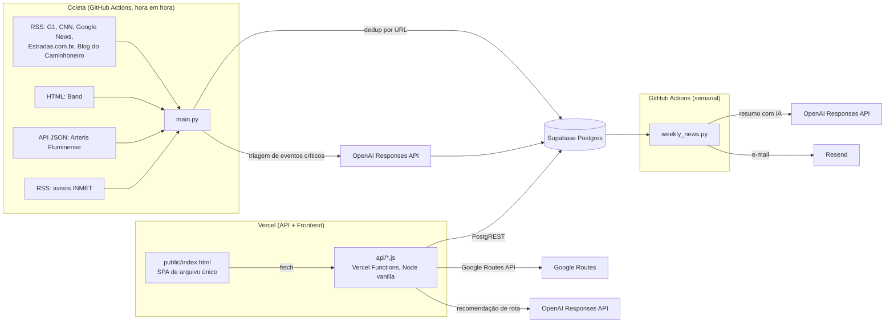

# Arquitetura — Road News

> Mantido por `tech-docs-agent`. Reflete o estado real do código — não a stack de referência aspiracional (ver [`CLAUDE.md`](../CLAUDE.md) e [`docs/adr/0001-arquitetura-de-subagents.md`](adr/0001-arquitetura-de-subagents.md)).

## Visão geral

Road News tem três componentes que rodam de forma desacoplada, sem framework de orquestração entre eles — cada um é implantado e escalado separadamente:

## Os três componentes

### 1. Coleta (`main.py` + `scraper/`)
Python 3.11, agendado pelo GitHub Actions (`.github/workflows/scraper.yml`, `cron: "0 * * * *"` — de hora em hora, mais disparo em push na `main` e manual). Lê `config/sources.yaml`, roda cada fonte (`scraper/sources/*.py`), filtra por keyword (`scraper/utils/filters.py`), grava no Postgres com dedup por `UNIQUE(url)` (`scraper/storage/postgres.py`), e roda a triagem de eventos logísticos críticos (`scraper/event_intelligence.py`) quando `EVENT_INTELLIGENCE_ENABLED=true`. Sem browser headless — só `feedparser`/`requests`/`BeautifulSoup4`.

Dono: `scraping-engineer` (fontes/coleta) + `data-pipeline-engineer` (persistência/dedup/entidade) — ver [`docs/AGENTS.md`](AGENTS.md).

### 2. API + Frontend (Vercel)
- **Frontend**: `public/index.html`, um único arquivo (~6.800 linhas) de HTML/CSS/JS vanilla — landing pública e painel logado (dashboard, alertas, mapa, Minha Rota, admin/gestor/developer) no mesmo arquivo, roteado no cliente via os `rewrites` de `vercel.json`. Sem build step, sem framework.
- **API**: `api/*.js`, Vercel Serverless Functions em Node.js puro (CommonJS), sem dependências npm, sem `package.json`. Cada arquivo exporta um `handler(req, res)`. Toda leitura/escrita de dado passa por chamadas REST diretas ao PostgREST do Supabase (`supabaseFetch` em `api/_auth.js`).

Dono: `frontend-engineer` (painel) + `backend-engineer` (endpoints de produto) + `saas-platform-engineer` (motor de auth/tenancy: `_auth.js`, `_admin.js`, `admin-*.js`).

### 3. Notificação semanal (`scraper/weekly_news.py`)
Roda toda segunda-feira 08:00 (America/Sao_Paulo) via `.github/workflows/weekly-news.yml`, gera um resumo operacional com IA (OpenAI) e envia por e-mail via Resend. Também disparável sob demanda pelo painel (`api/weekly-summary.js`) ou manualmente (`scripts/send_weekly_news.py`).

Dono: `notification-engineer` (entrega/template) + `ai-engineer` (chamada de IA) + `prompt-engineer` (texto do prompt).

## Multi-tenancy

Já implementada em produção, não é um plano futuro: tabelas `clients`, `profiles` (papéis `admin`/`manager`/`client`), `packages`, `user_packages`, `usage_events`, `audit_logs`, com RLS via funções `SECURITY DEFINER` no Postgres. O controle de acesso e quota do lado da API é centralizado em `api/_auth.js` (`requireAccount`, `assertCanUse`, `recordUsage`, `FEATURE_RULES`). Ver [`docs/DATABASE.md`](DATABASE.md) e [`docs/API.md`](API.md).

## Por que não há framework/Docker/headless browser

Essas ausências são decisões, não lacunas: `system-architect` só introduz uma peça nova da "stack de referência" (Next.js/NestJS, Playwright, Docker) quando uma limitação real e observada justificar, registrada em ADR. Ver [`docs/adr/`](adr/) e o roster de agentes em [`docs/AGENTS.md`](AGENTS.md).

## Limites conhecidos do desenho atual

- `public/index.html` é um único arquivo grande — navegável via busca/grep, mas sem separação de módulo. Ver `frontend-engineer` em `docs/AGENTS.md` para o critério de quando isso justifica ser fatiado.
- A API não tem testes rodando em CI (só localmente) — ver [`docs/CONTRIBUTING.md`](CONTRIBUTING.md).
- Extração de entidade (rodovia/km/UF) está hoje duplicada entre `scraper/utils/image_summary.py` (na coleta) e `api/news-feed.js` (na consulta) — consolidação é mandato aberto de `data-pipeline-engineer`.
